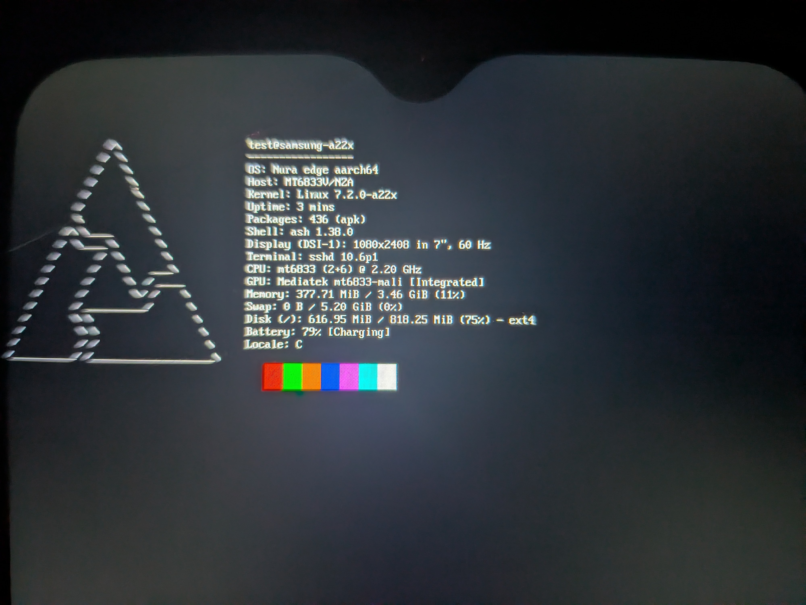

# YourLocalTechGuy

Just tinkering with mobile Linux ports, custom kernels, low-level system bring-up, and random hardware projects.

---

### Current Projects
- **postmarketOS on Samsung Galaxy A22 5G (`samsung-a22x`)**  
  Got pmOS up and running on the A22 5G.

  

- **Kernel & Device Bring-up:** Working through device trees, initramfs setups, and driver packaging.
- **Embedded & Low-Level:** Reverse engineering bootloaders, MediaTek/MStar firmware inspection, and playing around with custom engines/SIMD routines.

---

### Tech & Tools
C, Python, Bash, Linux / postmarketOS, Docker, git, radare2, mtkclient

---

### Contact
- **Discord:** `@yourlocaldevguy`
- **Email:** `yourlocaldevguy@gmail.com`
- **XDA:** `@yourlocaldevguy`
- **matrix:** `@sam:chat.yourlocaltechguy.dpdns.org`
